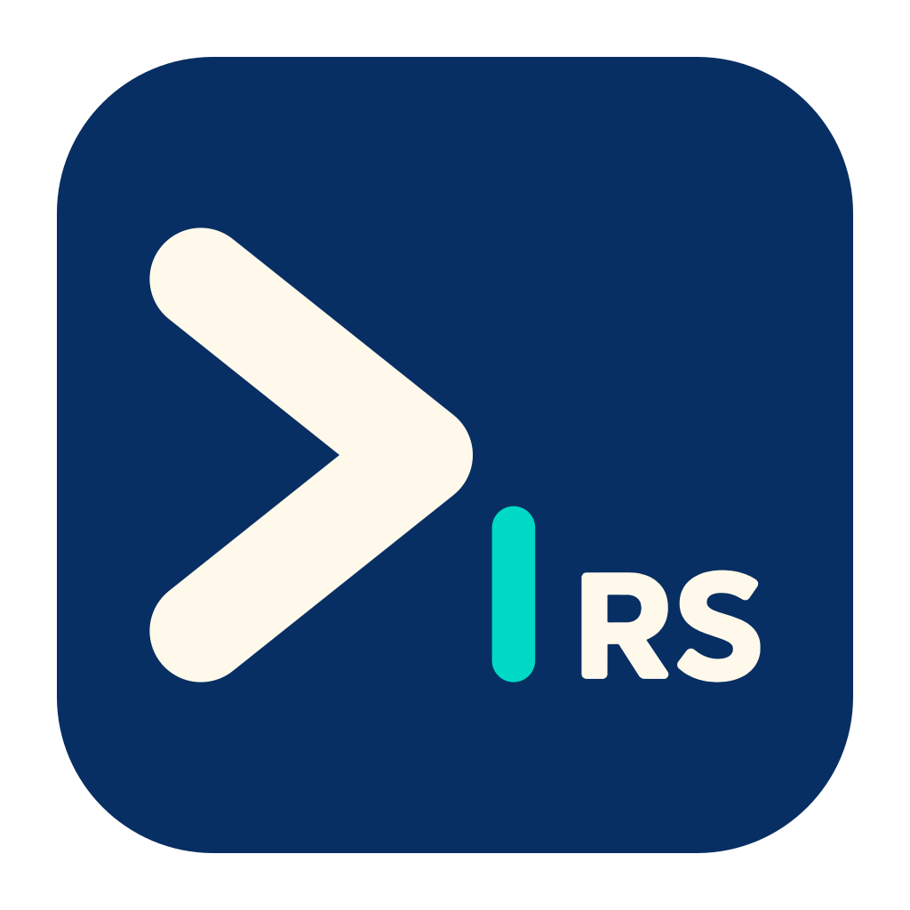
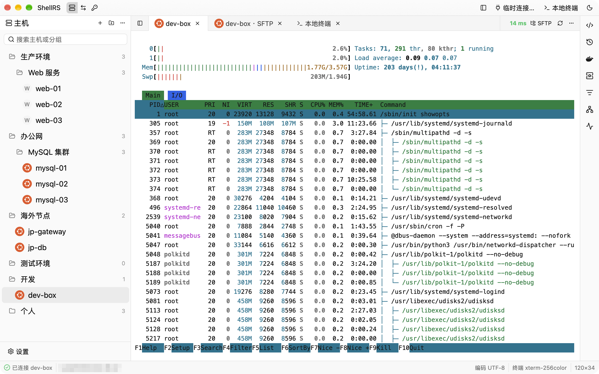
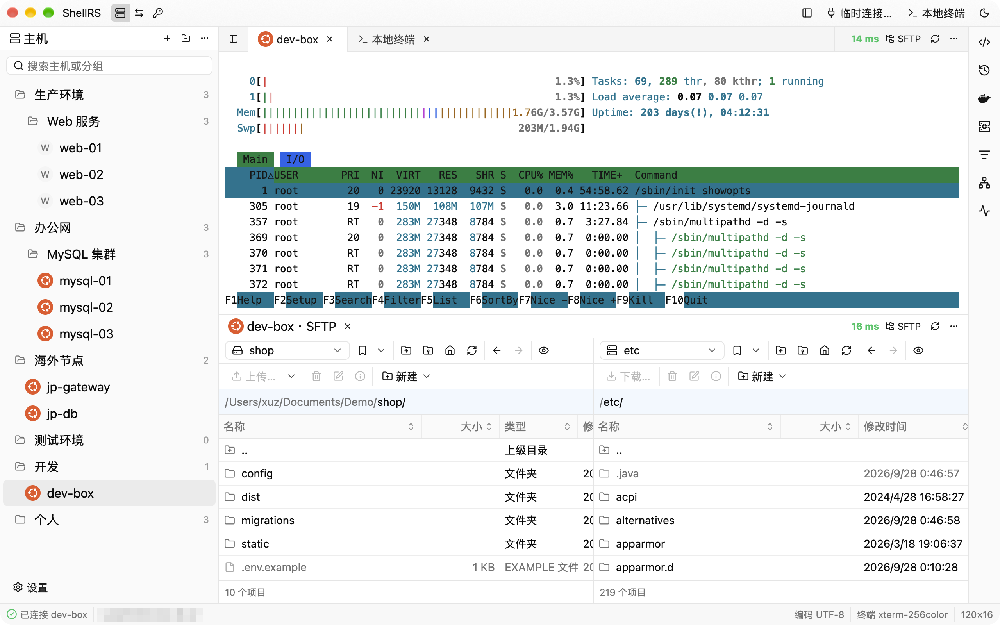
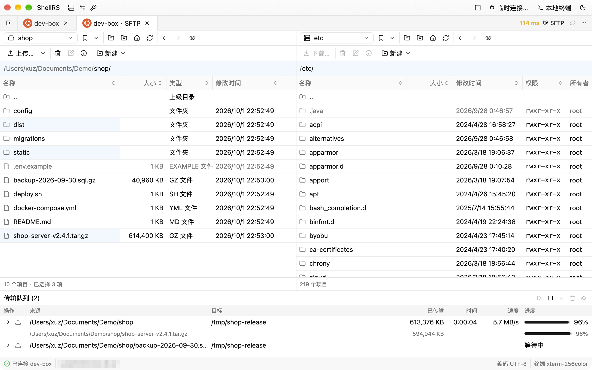
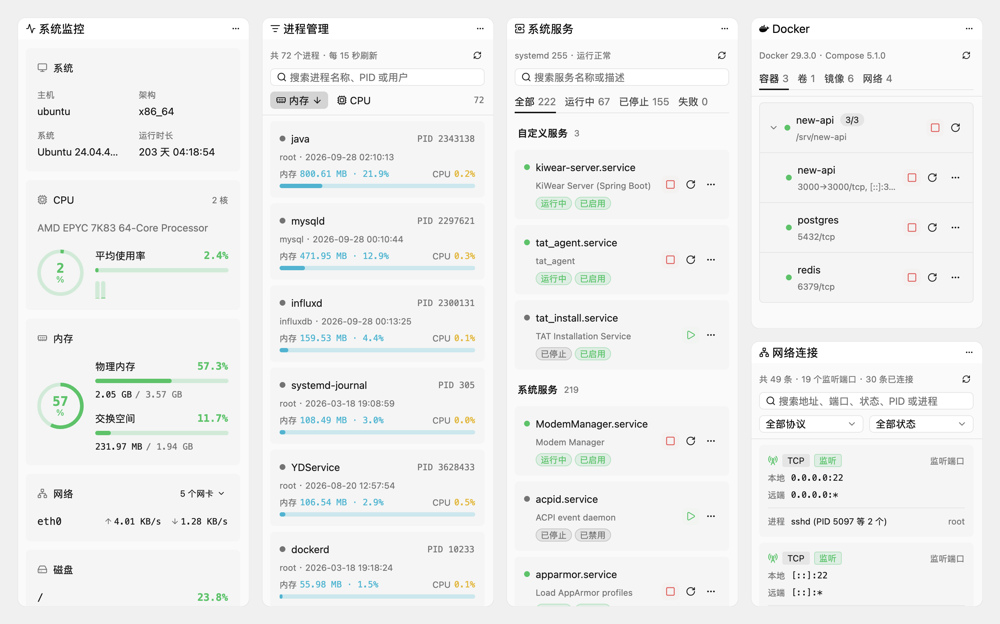

<p align="center">
  
</p>

<h1 align="center">ShellRS</h1>

<p align="center">
  基于 Rust 与 GPUI 构建的高性能、GPU 渲染原生跨平台 SSH 客户端<br>
  集成 Xshell 式主机管理、WinSCP 式双栏 SFTP 与 SSH 端口转发
</p>

<p align="center">
  <a href="https://github.com/Chillln/shell-rs/releases"></a>
  <a href="#许可证"></a>
  
  
</p>

> **说明**：本项目为 [Chillln/shell-rs](https://github.com/Chillln/shell-rs) 个人自用二开项目，基于原项目 [since2006/shell-rs](https://github.com/since2006/shell-rs) 定制。移除了应用内自动更新与遥测统计等模块，精简 GitHub Actions 构建流程，专注纯粹轻量的本地体验与 Windows 平台支持。

---

<picture>
  <source media="(prefers-color-scheme: dark)" srcset="docs/screenshots/main-dark.png">
  
</picture>

## 核心特性

- **主机与凭据管理**：支持多级嵌套分组、拖拽排序与实时过滤；自动识别远端系统类型；连接方式支持直连、多级跳板机及 HTTP/SOCKS5 代理。
- **安全第一**：密码与密钥口令仅存入系统原生钥匙串（Windows 凭据管理器 / macOS Keychain / Linux Secret Service），本地 SQLite 数据库绝不保存机密。
- **GPU 渲染终端**：基于 Zed 的 GPUI 框架与 `alacritty_terminal`，流畅低延迟；多标签支持自由分栏拆分；标签栏实时显示往返延迟。
- **WinSCP 风格 SFTP**：经典对称双栏文件浏览，支持递归拖拽上传/下载、断点续传及排队传输队列。
- **免二次登录的运维侧栏**：跟随当前终端会话，复用同一连接实时查看系统监控、进程列表、systemd 服务、Docker 容器以及历史命令与快捷代码片段。
- **端口转发**：图形化配置本地转发、远程转发与 SOCKS5 代理，附带实时连接拓扑图。
- **面向 AI Agent 的 CLI**：内置 `shellrs` 命令行工具，支持由 Claude Code、Codex 等 AI Agent 安全调度已存主机执行命令与同步文件，无需泄露密码。

## 界面预览

<p align="center">
  <br>
  <em>灵活分栏：终端与 SFTP 同屏联动</em>
</p>

<p align="center">
  <br>
  <em>WinSCP 风格双栏 SFTP 与传输队列</em>
</p>

<p align="center">
  <br>
  <em>右侧工具栏：系统监控、进程、服务、Docker</em>
</p>

## 快速上手

1. **新建主机**：按 `Ctrl+N`（macOS 为 `⌘N`）打开新建主机对话框，输入主机地址、端口与认证信息。
2. **连接终端**：在左侧树列表中双击主机即可快速打开终端标签。
3. **打开 SFTP**：右键主机选择「打开 SFTP」，或在终端标签栏右侧点击「SFTP」。
4. **侧栏切换**：标题栏左侧图标可切换「主机树 / 端口转发 / 凭据管理」，`Ctrl+Alt+B`（macOS 为 `⌘⌥B`）显示或折叠右侧运维工具箱。
5. **分栏布局**：按 `Ctrl+T`（macOS 为 `⌘T`）打开本地终端，拖动标签页边缘即可拆分为并排或上下视图。

## 源码构建

项目固定使用 Rust 1.98.1（由 `rust-toolchain.toml` 声明），首次编译会拉取并构建 GPUI 组件栈：

```sh
# 克隆仓库
git clone https://github.com/Chillln/shell-rs.git
cd shell-rs

# 运行开发版本
cargo run

# 构建发布二进制文件
cargo build --release
```

详细环境依赖与 Windows Inno Setup 打包流程请参考 [开发与测试文档](docs/development.md)。

## 致谢

- 原项目 [since2006/shell-rs](https://github.com/since2006/shell-rs)：出色的架构与交互设计
- [GPUI](https://github.com/zed-industries/zed) 与 [gpui-kit](https://gpui-kit.com)：高性能 GPU 界面框架
- [russh](https://github.com/Eugeny/russh) 与 [russh-sftp](https://github.com/AspectUnk/russh-sftp)：SSH 与 SFTP 协议支持
- [alacritty_terminal](https://crates.io/crates/alacritty_terminal) 与 [portable-pty](https://crates.io/crates/portable-pty)：终端模拟与 PTY
- [keyring](https://crates.io/crates/keyring)：操作系统原生钥匙串对接

## 许可证

本项目沿用原项目协议，基于 [GNU General Public License v3.0 (GPL-3.0)](LICENSE) 开放源代码。
